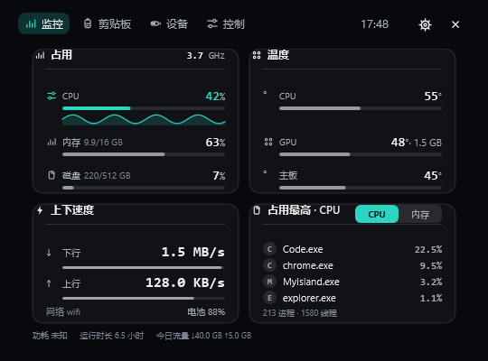
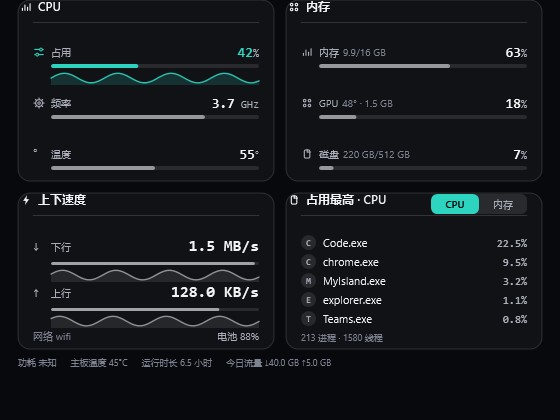
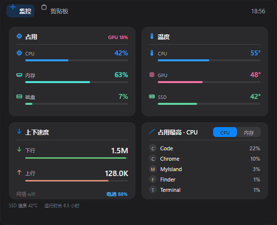
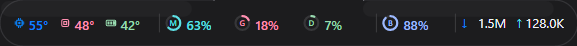
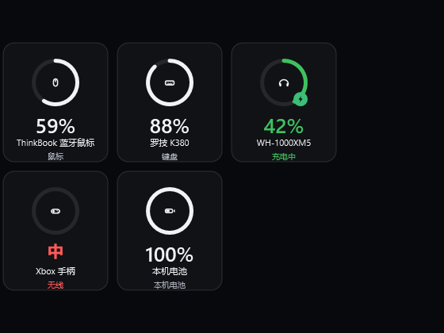

# MyIsland

MyIsland 是一款 Windows 与 macOS 菜单栏系统监控工具，以轻量胶囊展示实时指标，并提供可切换的小形象与主题。

**当前源码版本：1.1.2** · Windows WPF · macOS Avalonia · Apple Silicon 原生发布

Windows 与 macOS 各自一套原生实现（Windows WPF 自绘 + macOS Avalonia 自绘），共享
`src/Island.Core` 的数据模型与读数语义；两边共用的约定写在 [SOURCE-README.txt](SOURCE-README.txt)。

## 功能

- CPU、内存、GPU、磁盘和网络读数；可用功能随操作系统不同。
- **Windows**：灵动岛窗口、展开监控面板、快捷控制、剪贴板历史、小形象互动。
- **展开监控面板**：2×2 卡片栅格 + 栅格下方的**底部状态行**（运行时长 / 今日流量 / 功耗 / 温度，
  按平台支持情况出现；支持但读不到显示「未知」，平台不支持则不出现）。
- **Windows 外设电量**：WMI 电池 + MSBatteryClass + BLE GATT 直读（0x180F/0x2A19）+ XInput 手柄档位；
  读不到就不显示，不做百分比换算伪装。
- **2.4G 接收器电量**：HID 协议表（内置条目 + 用户 JSON 覆盖）+ 三层校验（标准 usage / 协议表 / 兜底）；
  内置表**只收已实机验证的条目**，未验证的候选不参与匹配 —— 宁可显示「未知」，不输出没验过的读数。
- **硬件详情面板**：列出硬件库枚举到的全部传感器（只读窗口；读不到的项显示「未知」，不填 0）。
- **macOS**：菜单栏胶囊、显示器控制（DDC/内置背光）、剪贴板历史、图片预览、设备页 per-type 矢量图标。
- 8 种小形象款式，支持视线、表情、眨眼、呼吸、互动弹跳和待机动作。
- 主题与紧凑视图自定义；「暗色科技」设计系统（一套主题 = 近黑中性色 + 一个强调色 + 状态色）。

## 界面截图


### 展开面板（Windows）



### 监控页（Windows / macOS 对照）

| Windows | macOS |
|---|---|
|  |  |

### 收起态（macOS 胶囊读数带）



### 设备页（Windows）



> 除 `macos-capsule.png` 为实机截屏外，其余图片是**离屏渲染**产物 —— 由 `tools/visual-probe`（Windows）
> 与 `tools/avalonia-probe`（macOS）直接渲染**产品源码**得到，不是设计稿，也不是另画的示意图。
> Windows 侧的设计对照见 `branding/ref/`。
>
> ⚠️ **macOS 两张图的顶栏只有「监控 / 剪贴板」**：这不是漏画 —— 「设备」「屏幕」两个页签需要 macOS 专属
> 工具链（IOKit 探针 / DDC），产品按 `OperatingSystem.IsMacOS()` 在非 macOS 环境下按逻辑隐藏，
> 离屏渲染如实复现了这个行为；**真机 Mac 上这两个页签存在**。

## 目录结构

```
├── src/                 Island.App(WPF/Windows) · Island.Avalonia(macOS) · Island.Core(模型) · Island.Native(PDH 采样)
├── tests/Island.Tests/  零依赖测试门禁（自研 harness，失败即非零退出码）
├── tools/               开发工具 + macOS 原生工具(Swift/ObjC)
├── packaging/           macOS / Windows / 便携版 打包脚本
├── branding/            品牌资产（Windows 图标 + mac/ 下的 macOS 图标）
├── driver/              PawnIO 温度驱动安装器（内嵌进程序，GPL-2.0，见 COPYING）
├── installer/           Inno Setup 安装包脚本
└── docs/                设计文档、改进记录、实机截图
```

## 验证与工具

改动都要过**门禁**，而且门禁覆盖到「看得见」这一层 —— 不只是「不崩」，还要像素级判定：

| 命令 | 作用 |
|---|---|
| `dotnet build Island.sln -c Release` | 必须 **0 警告 0 错误** |
| `dotnet run --project tests/Island.Tests -c Release` | 零依赖测试门禁，全过且退出码 0 |
| `dotnet run --project tools/visual-probe -c Release` | Windows 端**离屏渲染**视觉回归（防全黑 / 栅格几何 / 文本越界 / 卡内不压字） |
| `dotnet run --project tools/avalonia-probe -c Release` | macOS 端**离屏渲染**视觉回归（同一套判定口径） |
| `dotnet run --project tools/hid-probe -c Release -- --selftest` | 外设协议表自检：表合法性 + 本机外设命中层 + 工具与产品两路复核 |
| `powershell -ExecutionPolicy Bypass -File tools/verify-matrix.ps1` | 多机型验证矩阵（F1–F4 逐轴专项检查） |

两端的读数口径、字段位顺序与主题 token 语义都有**唯一真相源**（`src/Island.Core/Capabilities/`），
并由 `tests/Island.Tests` 的漂移检查守住 —— 清单改了、两端代码没跟着改，门禁立刻变红。
对外的能力清单与两端差异见 [docs/capabilities.md](docs/capabilities.md)。

### 还需要在别的机器上验证的

| 要做什么 | 在哪跑 | 把什么发回来 |
|---|---|---|
| macOS 原生探针的三项核对（C1） | 你的 Mac：`bash tools/mac-selfcheck.sh` | 报告 `docs/verification/mac-<日期>.md` |
| AMD / 台式机 / 核显+独显 / 其它 2.4G 接收器 | 对应机器：`powershell -ExecutionPolicy Bypass -File tools/verify-matrix.ps1` | 报告 `docs/verification/<机型>-<日期>.md` |

每份报告里「已核对且通过 / 已核对但不通过 / 没法核对」是分开写的 —— 没法核对不会被写成通过。
详见 [docs/verification/README.md](docs/verification/README.md)。

---
## 构建

需要 .NET 8 SDK。详细的 macOS 环境和原生工具说明见 [README-Mac.md](README-Mac.md)。

macOS Apple Silicon 发布：

```bash
bash packaging/macos/publish.sh
bash packaging/macos/make-app.sh
```

Windows 本机开发构建：

```powershell
dotnet build src/Island.App/Island.App.csproj -c Release
```

Windows 免管理员安装包（需要 Inno Setup 7 + Windows SDK 的 signtool）：

```powershell
powershell -ExecutionPolicy Bypass -File release.ps1
```

详见 [DISTRIBUTION.md](DISTRIBUTION.md)。

Windows 便携版和单文件版也可在 macOS 上交叉构建：

```bash
bash packaging/win/build-win.sh
```

Windows 安装程序需在 Windows 上使用 Inno Setup 编译。Windows 包应在 Windows 设备上进行实际验证。

## 安全说明

- AMD SMN 直读属于实验功能，默认关闭；它会加载未签名内核驱动并映射 PCIe 物理内存。
  项目**不分发**会安装未签名内核驱动的 `inpout` 二进制（`tools/inpout/*.dll` 已从版本库排除，
  仅保留在本机源码目录供调试）。启用前请先阅读源码中的风险说明。
- 温度读取走微软签名的 PawnIO 驱动：程序内嵌官方安装器，仅在以管理员运行且驱动缺失时静默安装。
  许可证全文见 `driver/COPYING-PawnIO.txt`。
- 发布包内会排除 `inpout*.dll` 与 `*.pdb`（见 `installer/MyIsland.iss` 的 `Excludes`）。

## 许可证

本项目使用 MIT License。第三方代码保留各自许可证，见 `tools/display-tools/NOTICE.txt` 及相邻许可文件。
